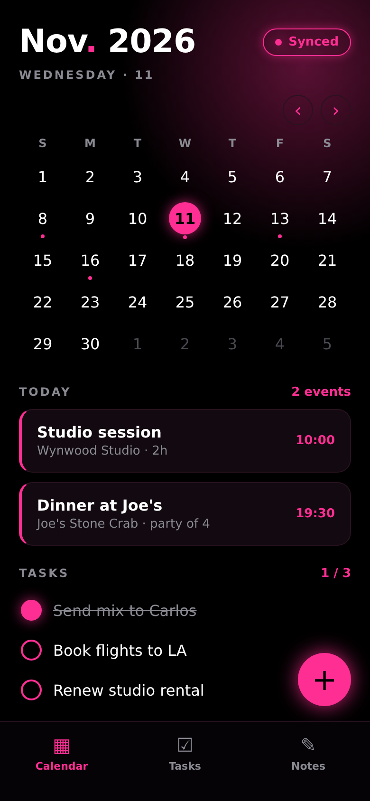
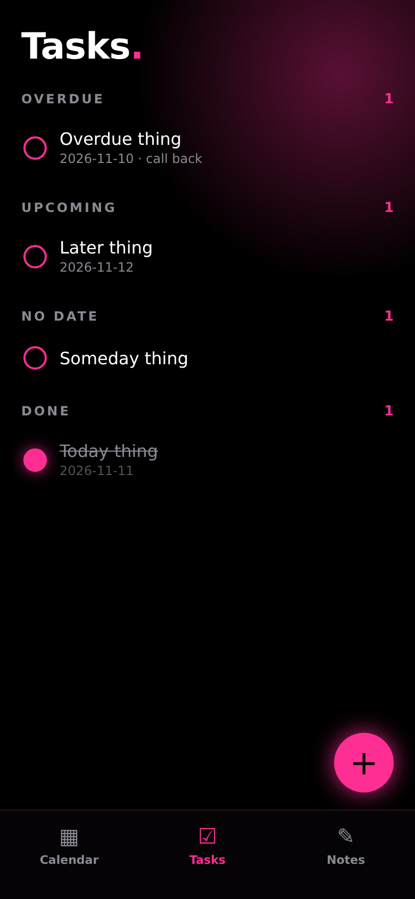
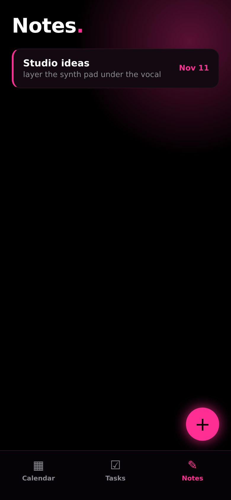
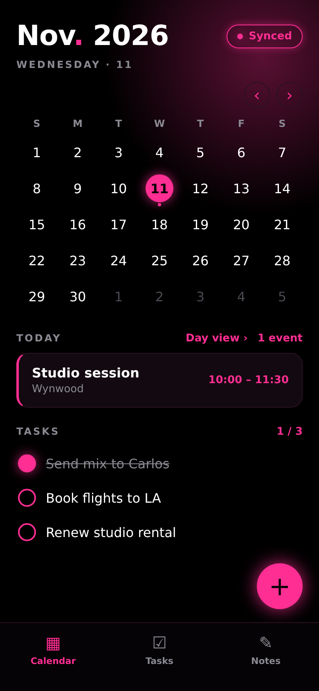
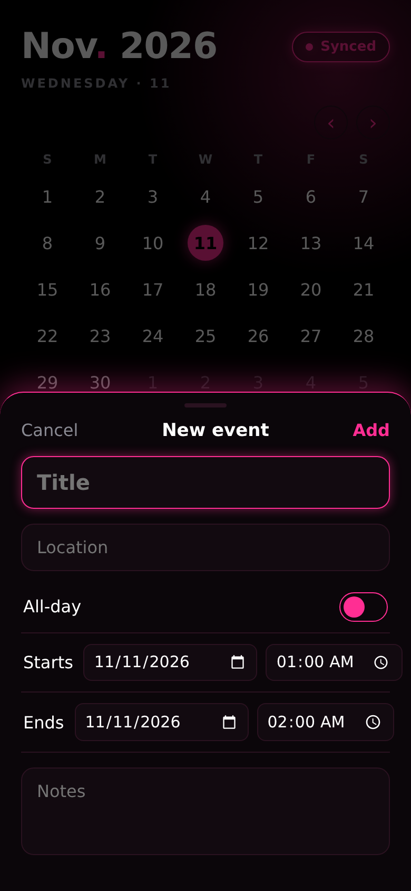
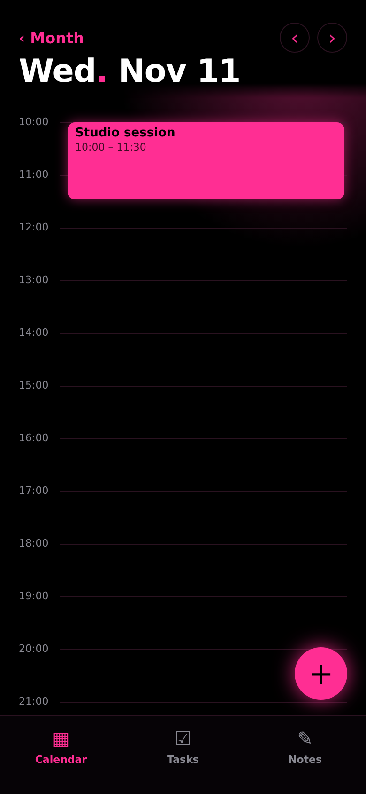

# Miami Organizer

Pink-and-black ("neon glow") organizer app for iOS and Android built with **Tauri 2**, React, TypeScript and Vite.
Events (create/edit/delete, month grid, day list and hourly day view), Tasks (due dates, sections) and Notes (autosaving editor, attach to a day) are implemented and persist locally. Apple Calendar sync arrives in a later ticket. Append `?seed=1` to the dev URL on a fresh install to load sample events.

## Architecture

- `src/` — React + TS frontend. Runs in a plain browser and inside Tauri.
- `src/data/repository.ts` — `Repository` interface; `localStorageRepository.ts` is the current implementation (swap for IndexedDB/SQLite later).
- `src/data/calendarProvider.ts` — `CalendarProvider` interface with a mock implementation. The real iOS EventKit provider is a later ticket.
- `src-tauri/` — Tauri 2 Rust shell (`lib.rs` carries the mobile entry point).

## Run in the browser (no toolchain needed)

```sh
npm install
npm run dev        # http://127.0.0.1:5173 — use a 390x844 viewport
npm run build      # typecheck + production build
npm test           # unit tests (vitest): date/event logic, task grouping, note helpers
```

## Run in Tauri desktop

Requires [Rust](https://rustup.rs) and the [Tauri prerequisites](https://tauri.app/start/prerequisites/) for your OS.

```sh
npm run tauri dev
```

## iOS (requires macOS + Xcode)

iOS projects can only be generated and built on a Mac with Xcode, CocoaPods and the iOS Rust targets
(`rustup target add aarch64-apple-ios aarch64-apple-ios-sim x86_64-apple-ios`).

```sh
npm run tauri ios init     # generates src-tauri/gen/apple (not committed here: needs Xcode)
npm run tauri ios dev      # simulator or device; set bundle.iOS.developmentTeam in tauri.conf.json for devices
```

## Android (requires Android Studio / SDK + NDK)

Set `ANDROID_HOME` and `NDK_HOME`, install the Rust targets
(`rustup target add aarch64-linux-android armv7-linux-androideabi i686-linux-android x86_64-linux-android`).

```sh
npm run tauri android init  # generates src-tauri/gen/android (not committed here: needs the SDK)
npm run tauri android dev
```

The mobile entry point (`#[cfg_attr(mobile, tauri::mobile_entry_point)]`) and `crate-type = ["staticlib","cdylib","rlib"]` are already configured, so `init` only has to generate the native projects.

## Not verified in the scaffold environment

The scaffold was built on Linux without Rust, Xcode or the Android SDK: the Tauri shell config is hand-written to Tauri 2 conventions and has not been compiled. The `src-tauri/icons/icon.png` is a placeholder; run `npm run tauri icon <source.png>` to generate the full icon set.

## Verification

See `.claude/skills/verify-app/SKILL.md` (mirrored in `.agents/skills/verify-app/`).





  
